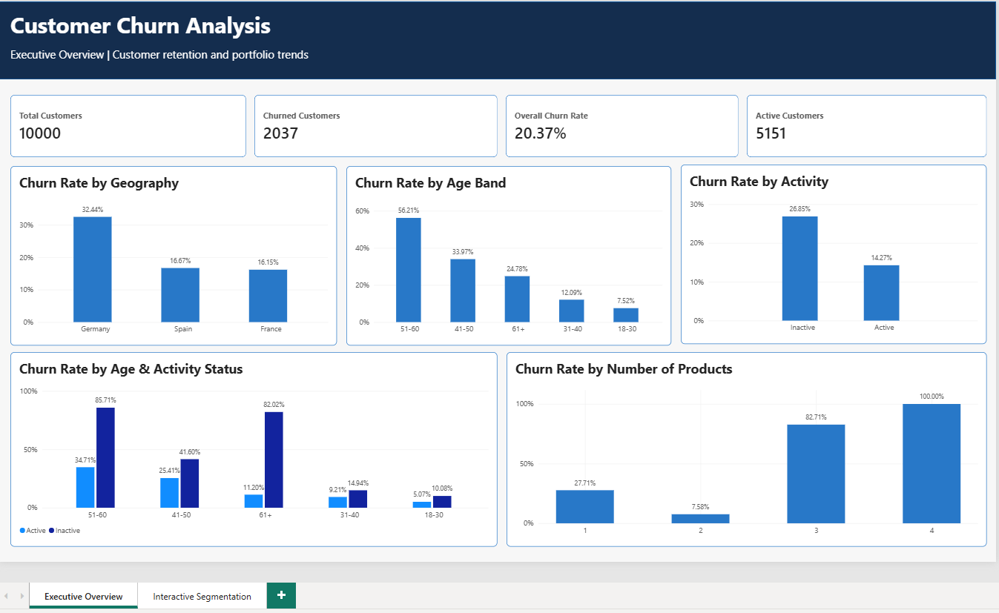
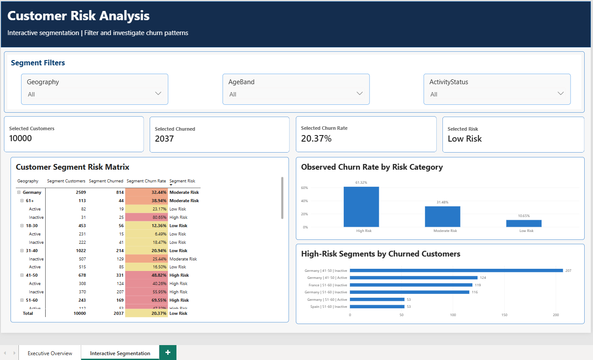

# Customer Churn Analysis

An end-to-end customer churn analysis project using **Python (Pandas), SQL Server / T-SQL, and Power BI**. The project explores historical churn patterns, compares customer segments, and presents findings in a two-page interactive dashboard.

> **Interpretation note:** These results describe observed historical patterns. They do not establish causation or predict an individual customer's probability of leaving.

## Business Questions

- What is the overall observed churn rate?
- How does churn vary by geography, age, gender, activity status, number of products, credit score, balance status, and tenure?
- Which combinations of geography, age band, and activity status have higher observed churn?
- Which segments contribute the largest number of churned customers, as distinct from having the highest churn rate?
- How can these findings be communicated through an interactive dashboard?

## Tools

- **Python / Pandas:** data loading, inspection, validation, cleaning, feature engineering, and exploratory analysis
- **SQL Server / T-SQL:** aggregations, CTEs, conditional analysis, ranking, and segment comparisons
- **Power BI:** DAX measures, slicers, KPI cards, matrix visual, conditional formatting, and dashboard storytelling
- **Git / GitHub:** version control and documentation

## Dataset

The original bank customer churn dataset contains **10,000 customer records and 14 columns**. The target field is `Exited` (`1` = exited, `0` = retained).

Original columns: `RowNumber`, `CustomerId`, `Surname`, `CreditScore`, `Geography`, `Gender`, `Age`, `Tenure`, `Balance`, `NumOfProducts`, `HasCrCard`, `IsActiveMember`, `EstimatedSalary`, `Exited`.

Initial validation found no missing values, duplicate rows, duplicate `CustomerId` values, or unexpected values in the checked categories.

**Source:** [Bank Customer Churn Prediction Dataset — Kaggle](https://www.kaggle.com/datasets/saurabhbadole/bank-customer-churn-prediction-dataset) by Saurabh Badole.

The CSV is intentionally not included in this repository package. Download it from the source page above and follow the dataset page's licence and redistribution terms. See [`data/README.md`](data/README.md) for setup instructions.

**Dataset citation:** Saurabh Badole, *Bank Customer Churn Prediction Dataset*, Kaggle. https://www.kaggle.com/datasets/saurabhbadole/bank-customer-churn-prediction-dataset

## Workflow

1. Load and explore the raw CSV using Pandas.
2. Inspect data types, distributions, missing values, duplicates, identifier uniqueness, categories, and ranges.
3. Remove fields not required for analysis (`RowNumber`, `Surname`) and create business-friendly analytical categories.
4. Explore churn rates and customer counts across individual attributes and combinations of attributes.
5. Load the prepared dataset into SQL Server and investigate segment patterns with T-SQL.
6. Build an executive overview and an interactive segment-risk analysis report in Power BI.
7. Validate headline totals and selected segment results across Python, SQL Server, and Power BI.

## Data Preparation

The cleaned dataset contains **10,000 rows and 16 columns**. Four analysis-friendly columns are added:

| Derived column | Purpose |
|---|---|
| `AgeBand` | 18–30, 31–40, 41–50, 51–60, and 61+ |
| `ActivityStatus` | Active / Inactive labels derived from `IsActiveMember` |
| `CreditScoreBand` | Poor, Fair, Good, and Very Good |
| `BalanceStatus` | Zero Balance / Non-zero Balance |

The source field `Exited` is retained as the outcome variable. Customer counts are reviewed alongside rates so that small segments are not judged by percentages alone.

## Key Findings

Overall, **2,037 of 10,000 customers exited**, an observed churn rate of **20.37%**.

| Segment | Observed churn rate |
|---|---:|
| Germany | 32.44% |
| Age 51–60 | 56.21% |
| Inactive customers | 26.92% |
| Customers with 3 products | 82.71% |
| Customers with 4 products | 100.00% |
| Non-zero balance | 24.08% |
| Zero balance | 13.82% |

The product-count results require caution: the three-product group contains 266 customers and the four-product group contains only 60 customers.

### Segment examples

- **Germany, age 51–60, inactive:** 131 customers, 116 exited, **88.55% observed churn**
- **Germany, age 41–50, inactive:** 370 customers, 207 exited, **55.95% observed churn**

A segment with a high churn rate does not necessarily contribute the largest number of churned customers. The report therefore shows both rate and volume.

### Project-defined risk categories

- **High Risk:** segment observed churn rate ≥ 40%
- **Moderate Risk:** segment observed churn rate ≥ 25% and < 40%
- **Low Risk:** segment observed churn rate < 25%

| Category | Customers | Churned customers | Observed churn rate |
|---|---:|---:|---:|
| High Risk | 1,215 | 745 | 61.32% |
| Moderate Risk | 1,712 | 539 | 31.48% |
| Low Risk | 7,073 | 753 | 10.65% |
| **Total** | **10,000** | **2,037** | **20.37%** |

These are descriptive categories created for this project, not official bank risk ratings or a validated predictive model. The overall churn rate falling below the 25% threshold should not be interpreted as proof that the portfolio is safe.

## Power BI Dashboard

### Page 1 — Executive Churn Overview

- Total customers, churned customers, overall churn rate, and active customers
- Churn rate by geography
- Churn rate by age band
- Churn rate by activity status
- Churn rate by age band and activity status
- Churn rate by number of products



### Page 2 — Interactive Segmentation

- Geography, age-band, and activity-status slicers
- Dynamic selected-segment KPI cards
- Customer segment risk matrix with conditional formatting
- Customer counts by risk category
- Observed churn rate by risk category
- Top high-risk segments ranked by churned-customer count



## Repository Structure

```text
Customer_Churn_Analysis/
├── data/
│   ├── raw/                 # Downloaded source CSV; not committed
│   ├── processed/           # Generated cleaned CSV; not committed
│   └── README.md
├── scripts/
│   ├── explore_data.py
│   └── clean_data.py
├── sql/
│   └── analysis.sql
├── powerbi/
│   └── customer_churn_analysis_dashboard.pbix
├── screenshots/
│   ├── executive_overview.png
│   └── customer_risk_analysis.png
├── README.md
├── requirements.txt
└── .gitignore
```

## How to Reproduce the Analysis

### 1. Clone the repository

```bash
git clone <YOUR_GITHUB_REPOSITORY_URL>
cd Customer_Churn_Analysis
```

### 2. Obtain the dataset

Place the CSV at:

```text
data/raw/Churn_Modelling.csv
```

Use the original dataset source and comply with its licence terms.

### 3. Create a Python environment

```bash
python -m venv .venv
```

On Windows:

```bash
.venv\Scripts\activate
```

On macOS / Linux:

```bash
source .venv/bin/activate
```

Install dependencies:

```bash
pip install -r requirements.txt
```

### 4. Run the Python scripts

Run these commands from the repository root:

```bash
python scripts/explore_data.py
python scripts/clean_data.py
```

The cleaning script writes `data/processed/customer_churn_clean.csv`. Check the paths at the top of each script if you run them from another working directory.

### 5. Run the SQL analysis

In SQL Server, create a database named `CustomerChurnAnalysis`, import `data/processed/customer_churn_clean.csv` into a table named `customer_churn_clean`, and execute [`sql/analysis.sql`](sql/analysis.sql).

Make sure the table's column names and types match the cleaned CSV. The SQL file assumes the table already exists.

### 6. Open the Power BI report

Open [`powerbi/customer_churn_analysis_dashboard.pbix`](powerbi/customer_churn_analysis_dashboard.pbix). If the report references a local SQL Server instance or file path, update the data source settings and refresh it.

## Limitations

- This is exploratory analysis of one dataset, not a production churn prediction system.
- Observed associations do not establish causation.
- Small groups require cautious interpretation.
- Risk categories use project-defined thresholds and are not validated risk scores.
- No predictive model or out-of-sample validation is claimed.

## Potential Next Steps

- Add statistical uncertainty or significance checks for selected comparisons.
- Develop and validate a separate churn prediction model.
- Add automated data-quality tests and a reproducible database-loading process.

## Author

**Mohit Mulani**  
Aspiring Data Analyst | SQL | Python | Power BI | Excel | Tableau

- GitHub: [mohitmulani](https://github.com/mohitmulani)
- LinkedIn: Add your LinkedIn profile URL

---

*Created for learning and portfolio demonstration. Business decisions should not be based on descriptive results alone.*
